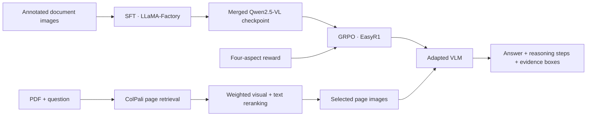

# HERA-VLM

**Hierarchical evidence-grounded reasoning paths within multimodal RAG**

[Training and data](docs/training.md) · [Reward specification](docs/reward.md)

## Overview



The training reward uses **ColQwen2** to assess reasoning-step/image-region alignment. The application uses **ColPali** for document-page retrieval. These are separate components.

## What is included

- A batch reward function for answer accuracy, final evidence grounding, stepwise attribution, and output format.
- A GRPO template whose reward arguments match the manuscript-aligned full reward function.
- The supplied order-only ablation configuration with portable paths, retained as reference.
- LLaMA-Factory SFT and LoRA export templates, plus illustrative data schemas.
- A Gradio PDF QA application with single-page and multiple-page inference, ranking inspection, and evidence visualization.

```text
app/                 PDF retrieval, reranking, inference, and visualization
configs/sft/         New SFT and LoRA export templates
configs/rl/          Full reward template and order-only reference
reward_functions/    Manuscript-aligned four-aspect reward implementation
prompts/             New structured-output prompt template
examples/            Synthetic schema examples; no real training data
scripts/             Static validation and reward test launcher
tests/               Equation and batch integration tests
docs/               Training guide, reward details, and provenance
```

## Training: SFT → GRPO

1. Prepare image/question/answer samples with numbered reasoning steps and evidence boxes.
2. Run SFT then export a merged checkpoint.
3. Use that checkpoint to initialize GRPO and optimize the four-aspect reward.
4. Export the selected RL checkpoint in Hugging Face format, including its processor, and load it in the application.

The supplied RL YAML originally resumed an existing RL checkpoint and referenced an **order-only** reward file that was not supplied. `configs/rl/full_reward.yaml` instead starts from an SFT checkpoint and uses the full reward implementation. It is an adapted template, not the exact configuration of an existing experiment. See [training instructions](docs/training.md) for commands and data preparation.

## Four-aspect reward

With the full reward function's entry-point defaults:

\[
R = R_{\mathrm{answer}} + R_{\mathrm{ground}} + R_{\mathrm{path}} + R_{\mathrm{format}}.
\]

All four aspect weights are `1.0`. Grounding follows `0.9 S_h-IoU + 0.1 (S_cov + S_merge)` and can reach `1.1`; the total reward is an unnormalized sum in `[0, 4.1]`.

| Component | What it checks |
| --- | --- |
| Answer | Exact match, token F1, and sentence-embedding similarity |
| Grounding | Hybrid IoU (0 below/equal to 0.1, raw IoU between thresholds, 1 at/above 0.5), plus coverage and merged-evidence bonuses |
| Path | Answer gate ≥ 0.6, then 0.4 × proportion of valid ColQwen2-aligned steps + 0.6 × proportion of non-decreasing hierarchy transitions |
| Format | Exactly one ordered `<think>`, `<answer>`, and `<evidence>` block, numbered steps, and parseable boxes for answerable examples |

Each reference step carries a `hierarchy_level` of `1` (section), `2` (subsection), or `3` (detailed evidence). Predicted steps are matched to reference steps by text semantic similarity. Step evidence passes at ColQwen2 similarity ≥ `0.5`; the order score is the fraction of adjacent non-decreasing level transitions. See [the equations and implementation conventions](docs/reward.md).

Example output (illustrative only):

```xml
<think>
Step 1: Locate the requirement. {Image index: 1, box 2d: [100, 200, 800, 300]}
Step 2: Read the specified width. {Image index: 1, box 2d: [100, 400, 800, 500]}
</think>
<answer>The required width is 1.2 m.</answer>
<evidence>[{Image index: 1, box 2d: [100, 400, 800, 500]}]</evidence>
```

Coordinates are `[x1, y1, x2, y2]` pixels by default. Image indices are 1-based positions in the model's input image list, not necessarily original PDF page numbers.

## PDF QA demo

Use a separate environment for the application. Install a CUDA-compatible PyTorch build and the dependencies listed below; the original environment lockfile was not supplied.

```bash
python -m venv .venv
source .venv/bin/activate
python -m pip install -r requirements-app.txt
export QWEN_MODEL_PATH=/absolute/path/to/merged-or-full-rl-checkpoint
python app/app_revised_weighted_rerank_single_or_multiple.py
```

The checkpoint directory must include model weights, tokenizer, and processor assets. An unmerged LoRA adapter alone is insufficient for the current loader. CUDA inference uses bitsandbytes 4-bit quantization for Qwen; ColPali and the text encoder also consume memory. CPU loading is present but practical latency and memory requirements have not been benchmarked.

The app renders PDF pages at 200 DPI, retrieves five candidates by default, and reranks them using:

\[
s(p)=0.8\,\operatorname{minmax}(s_{\mathrm{ColPali}}(p))+0.2\,\operatorname{minmax}(s_{\mathrm{text}}(p)).
\]

Text similarity uses `BAAI/bge-base-en-v1.5` over extracted PDF text. Single-page inference defaults to one page; multiple-page inference defaults to three. Scanned PDFs without extractable text receive a placeholder in the text reranker; OCR is not included.

| Environment variable | Default / purpose |
| --- | --- |
| `QWEN_MODEL_PATH` | `checkpoints/hera-vlm-rl`; local full/merged model directory |
| `COLPALI_MODEL_ID` | `vidore/colpali-v1.2-hf` |
| `TEXT_MODEL_ID` | `BAAI/bge-base-en-v1.5` |
| `GRADIO_SHARE` | `false`; set to `true` to request a public Gradio link |

## Validation

```bash
python scripts/validate_release.py
# Equation and batch tests (requires Pillow; neural encoders are mocked):
python scripts/smoke_reward.py
```

## Acknowledgements

Built around [Qwen2.5-VL](https://huggingface.co/Qwen/Qwen2.5-VL-7B-Instruct), [ColPali](https://huggingface.co/vidore/colpali-v1.2-hf), and [ColQwen2](https://huggingface.co/vidore/colqwen2-v1.0-hf). Framework usage follows their official documentation; dependencies and model assets retain their respective licenses. This repository is licensed under the [MIT License](LICENSE), retained from the existing GitHub repository.
