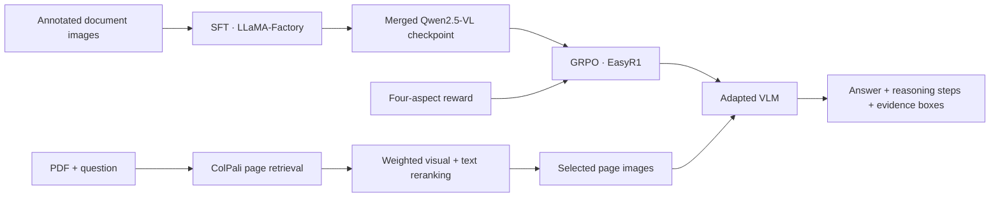

# HERA-VLM

**Hierarchical evidence-grounded reasoning paths within multimodal RAG**

HERA-VLM combines multimodal retrieval with a Qwen2.5-VL-7B model adapted through **supervised fine-tuning (SFT) with LLaMA-Factory** and **GRPO reinforcement learning with EasyR1**. It is designed to answer document questions while returning structured reasoning steps and page-level bounding-box evidence.

[中文说明](README.zh-CN.md) · [Training and data](docs/training.md) · [Reward specification](docs/reward.md) · [Release notes](docs/release-notes.md)

> This repository packages the supplied reward implementation and PDF QA application, together with newly prepared training templates. Training data, model checkpoints, original SFT hyperparameters, and evaluation results are not included. The templates have not been validated by a full GPU training run.

## Overview



The training reward uses **ColQwen2** to assess reasoning-step/image-region alignment. The application uses **ColPali** for document-page retrieval. These are separate components.

## What is included

- A batch reward function for answer accuracy, final evidence grounding, stepwise attribution, and output format.
- A GRPO template whose reward arguments match the supplied full reward function.
- The supplied order-only ablation configuration with portable paths, retained as reference.
- LLaMA-Factory SFT and LoRA export templates, plus illustrative data schemas.
- A Gradio PDF QA application with single-page and multiple-page inference, ranking inspection, and evidence visualization.

```text
app/                 PDF retrieval, reranking, inference, and visualization
configs/sft/         New SFT and LoRA export templates
configs/rl/          Full reward template and order-only reference
reward_functions/    Supplied four-aspect reward implementation
prompts/             New structured-output prompt template
examples/            Synthetic schema examples; no real training data
scripts/             Static validation and an offline reward smoke check
docs/               Training guide, reward details, and provenance
```

## Training: SFT → GRPO

1. Prepare image/question/answer samples with numbered reasoning steps and evidence boxes.
2. Run SFT with LLaMA-Factory, then export a merged checkpoint.
3. Use that checkpoint to initialize EasyR1 GRPO and optimize the four-aspect reward.
4. Export the selected RL checkpoint in Hugging Face format, including its processor, and load it in the application.

The supplied RL YAML originally resumed an existing RL checkpoint and referenced an **order-only** reward file that was not supplied. `configs/rl/full_reward.yaml` instead starts from an SFT checkpoint and uses the full reward implementation. It is an adapted template, not the exact configuration of an existing experiment. See [training instructions](docs/training.md) for commands and data preparation.

## Four-aspect reward

With the full reward function's entry-point defaults:

\[
R = 0.35R_{\mathrm{answer}} + 0.30R_{\mathrm{ground}} + 0.25R_{\mathrm{path}} + 0.10R_{\mathrm{format}}.
\]

| Component | What it checks |
| --- | --- |
| Answer | Exact match, token F1, and sentence-embedding similarity |
| Grounding | Matched IoU, gold coverage, merged-gold IoU, soft IoU, and coordinate validity |
| Path | ColQwen2 support for cited regions, box overlap, and alignment with the annotated step order; gated by answer accuracy |
| Format | Exactly one ordered `<think>`, `<answer>`, and `<evidence>` block, numbered steps, and parseable boxes for answerable examples |

The order score is **dense**, combining monotonic transitions and coverage. It is not a binary all-steps-correct test. The implementation includes separate rules for unanswerable examples. See [the exact formulas and caveats](docs/reward.md).

Example output (illustrative only):

```xml
<think>
Step 1: Locate the requirement. {Image index: 1, box 2d: [100, 200, 800, 300]}
Step 2: Read the specified width. {Image index: 1, box 2d: [100, 400, 800, 500]}
</think>
<answer>The required width is 1.2 m.</answer>
<evidence>[{Image index: 1, box 2d: [100, 400, 800, 500]}]</evidence>
```

Coordinates are `[x1, y1, x2, y2]` pixels by default. Image indices are 1-based positions in the model's input image list, not necessarily original PDF page numbers.

## PDF QA demo

Use a separate environment for the application. Install a CUDA-compatible PyTorch build and the dependencies listed below; the original environment lockfile was not supplied.

```bash
python -m venv .venv
source .venv/bin/activate
python -m pip install -r requirements-app.txt
export QWEN_MODEL_PATH=/absolute/path/to/merged-or-full-rl-checkpoint
python app/app_revised_weighted_rerank_single_or_multiple.py
```

The checkpoint directory must include model weights, tokenizer, and processor assets. An unmerged LoRA adapter alone is insufficient for the current loader. CUDA inference uses bitsandbytes 4-bit quantization for Qwen; ColPali and the text encoder also consume memory. CPU loading is present but practical latency and memory requirements have not been benchmarked.

The app renders PDF pages at 200 DPI, retrieves five candidates by default, and reranks them using:

\[
s(p)=0.8\,\operatorname{minmax}(s_{\mathrm{ColPali}}(p))+0.2\,\operatorname{minmax}(s_{\mathrm{text}}(p)).
\]

Text similarity uses `BAAI/bge-base-en-v1.5` over extracted PDF text. Single-page inference defaults to one page; multiple-page inference defaults to three. Scanned PDFs without extractable text receive a placeholder in the text reranker; OCR is not included.

| Environment variable | Default / purpose |
| --- | --- |
| `QWEN_MODEL_PATH` | `checkpoints/hera-vlm-rl`; local full/merged model directory |
| `COLPALI_MODEL_ID` | `vidore/colpali-v1.2-hf` |
| `TEXT_MODEL_ID` | `BAAI/bge-base-en-v1.5` |
| `GRADIO_SHARE` | `false`; set to `true` to request a public Gradio link |

## Validation and limitations

```bash
python scripts/validate_release.py
# Dependency-free component check:
python scripts/smoke_reward.py
```

The static check validates Python syntax, example JSON, reward keyword compatibility, and README links. The smoke check executes selected dependency-free functions extracted from the source; it does not import the complete reward module or download models. Neither establishes neural reward quality, GPU compatibility, or training convergence.

No benchmark scores or performance improvements are claimed in this release. Full reproducibility still requires the original dataset splits, framework revisions, environment versions, SFT configuration, and evaluation protocol. The app's minimum image resolution and maximum page count differ from the supplied RL settings; align them before controlled comparisons.

## Acknowledgements

Built around [LLaMA-Factory](https://github.com/hiyouga/LLaMA-Factory), [EasyR1](https://github.com/hiyouga/EasyR1), [Qwen2.5-VL](https://huggingface.co/Qwen/Qwen2.5-VL-7B-Instruct), [ColPali](https://huggingface.co/vidore/colpali-v1.2-hf), and [ColQwen2](https://huggingface.co/vidore/colqwen2-v1.0-hf). Framework usage follows their official documentation; dependencies and model assets retain their respective licenses. This repository is licensed under the [MIT License](LICENSE), retained from the existing GitHub repository.
